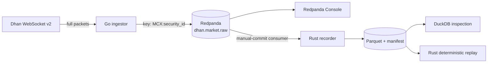

# GOLDLAB: Dhan → Go → Redpanda → Parquet

GOLDLAB is a local-first market-data research pipeline for MCX GOLD futures and
options. The existing Go service authenticates with Dhan, resolves 48 GOLD
contracts, subscribes in full-feed mode, and publishes raw packets to
Redpanda. The Rust recorder consumes those records into durable,
Zstandard-compressed Parquet.

This repository does **not** place orders. Q002 ends at deterministic replay of
auditable market-data recordings.



## What counts as proof

A human live test passes only when all of these agree:

1. Redpanda and Console are healthy.
2. Redpanda contains keyed future, CE, and PE records.
3. The recorder reports a durable Parquet batch before committing offsets.
4. DuckDB row count equals distinct Kafka source-coordinate count.
5. The recorder consumer-group offset reaches the recorded final offset with
   zero lag.

Screenshots are useful operational evidence, but they do not prove recovery or
exactly-once behavior. The deterministic crash-boundary tests remain required.

### Known-good reference run

The Q001 audit on 2026-10-29 produced this reconciled evidence. These numbers
are a reference, not fixed thresholds for future live sessions:

| Check | Observed result |
| --- | ---: |
| Redpanda source range | partition 0, offsets 0–71187 |
| Parquet rows | 71,188 |
| Distinct source coordinates | 71,188 |
| Duplicate source coordinates | 0 |
| Packet shape | type 8, 162 raw bytes |
| Parquet compression | ZSTD |
| Recorder committed offset | 71,188 |
| Recorder group lag after catch-up | 0 |

## Prerequisites

- Docker Desktop or another Docker Compose-compatible runtime.
- Go matching `go.mod` (currently Go 1.26.4).
- Rust stable and Cargo.
- CMake, used to build vendored librdkafka for the Rust consumer.
- `jq` for manifest inspection.
- DuckDB CLI for visual Parquet checks.
- An active Dhan data plan and a root `.env` containing:

```dotenv
CLIENT_ID=...
TOTP_KEY=...
DPIN=...
```

Never commit or screenshot `.env`, `auth.json`, access tokens, DPINs, TOTP
secrets, or authenticated WebSocket URLs.

## Fast offline verification

This does not require a live market or Dhan credentials. It validates the Go
code and the Rust recorder against the three exact Q000 broker fixtures.

```sh
go test ./...
go vet ./...
cargo fmt --all --check
cargo clippy --workspace --all-targets -- -D warnings
cargo test --workspace --locked
```

Visual pass condition: every command exits successfully. The Rust suite should
show the fixture, malformed-input, duplicate-coordinate, bounded-buffer, and
crash/restart tests as `ok`, plus deterministic replay and ordering tests.

## Replay a recording offline

Replay needs neither Dhan credentials nor a running Redpanda broker:

```sh
cargo run -p goldlab-replay --release -- \
  --input "${GOLDLAB_TEST_OUTPUT}" \
  --speed max \
  --output /tmp/goldlab-replay.jsonl
```

Run it twice against an unchanged recording. The result JSONL bytes and the
printed `checksum_sha256` must match. The replay fails on checksum corruption,
unmanifested files, duplicate offsets, or decreasing offsets; source gaps are
counted and reported. See [the Q002 replay guide](docs/q002-replay.md) for the
visual proof procedure, wall-clock mode, ordering policy, and limitations.

## Live end-to-end test

Run this during an open MCX market session. Use separate terminals so each
stage remains visible.

### Terminal 1 — start infrastructure

```sh
make up
make topic
docker compose ps
docker compose exec -T redpanda rpk topic describe dhan.market.raw \
  --brokers redpanda:9092 --print-partitions
```

Visual proof:

- `redpanda` is `healthy`.
- `console` is `running`.
- Topic `dhan.market.raw` exists.
- Note the partition-0 `HIGH-WATERMARK`; this is the before-test baseline.

Open <http://localhost:8080> and navigate to **Topics → dhan.market.raw →
Messages**. Keep this page open.

### Terminal 2 — start the recorder

Use a unique group and output directory so an earlier committed offset cannot
hide records from this run:

```sh
export GOLDLAB_TEST_ID="$(date -u +%Y%m%dT%H%M%SZ)"
export GOLDLAB_TEST_OUTPUT="recordings/manual-${GOLDLAB_TEST_ID}"
export GOLDLAB_TEST_GROUP="goldlab-recorder-manual-${GOLDLAB_TEST_ID}"

GOLDLAB_CODE_REVISION="$(git rev-parse HEAD)" \
  cargo run -p goldlab-recorder --release -- \
  --broker localhost:19092 \
  --topic dhan.market.raw \
  --group "${GOLDLAB_TEST_GROUP}" \
  --output "${GOLDLAB_TEST_OUTPUT}" \
  --max-records 1000 \
  --max-bytes 8388608 \
  --rotate-seconds 2
```

Visual proof: after records arrive, the terminal prints messages shaped like
the following. Counts vary; do not compare market values to this example.

```text
INFO ... recorder started ...
INFO ... durable Parquet batch committed rows=... files=... received=... written=...
```

The phrase `durable Parquet batch committed` is logged only after Parquet and
the manifest are finalized and the Kafka offset commit succeeds.

### Terminal 3 — start live Dhan ingestion

```sh
go run ./dhan-redpanda-starter/cmd/ingest
```

Visual proof: startup reports `instruments=48`, broker
`localhost:19092`, and topic `dhan.market.raw`. The 48 selected contracts are:

- 4 futures: GOLDM, GOLD, GOLDPETAL, and GOLDGUINEA.
- 22 GOLDM options: 11 CE and 11 PE.
- 22 GOLD options: 11 CE and 11 PE.

Leave it running long enough for several recorder batches. If the topic already
contains retained records, the fresh recorder group may process that backlog
before new live packets arrive.

### Browser — prove the broker contract visually

In Redpanda Console, refresh the Messages view and inspect multiple keys.

For each selected message, verify:

- Key is `MCX:<security_id>`.
- Value is JSON with exactly the current contract fields:
  `exchange_code`, `security_id`, `received_at`, and `raw_packet`.
- `exchange_code` is `MCX`.
- Key security ID matches the JSON security ID.
- Full-feed `raw_packet` begins with `08a20005` and contains 324 hex
  characters, representing 162 bytes.
- At least one future, one CE, and one PE security ID appears. Match IDs to the
  latest `resolved-contracts-*.csv`; do not infer option type from price.

Do not screenshot the Console configuration page if it exposes broker or
authentication details.

### Stop cleanly

Press Ctrl+C in the Go ingestor terminal, then Ctrl+C in the recorder terminal.
The recorder must print:

```text
INFO ... shutdown requested
INFO ... recorder stopped cleanly received=... written=... deduplicated=...
```

If a partial batch exists, a final `durable Parquet batch committed` line must
appear before `recorder stopped cleanly`.

## Inspect the recorded evidence

### 1. Files and manifest

```sh
find "${GOLDLAB_TEST_OUTPUT}" -type f | sort
jq '{
  files: (.files | length),
  rows: ([.files[].row_count] | add),
  range_rows: ([.files[].ranges[] |
    (.last_offset - .first_offset + 1)] | add),
  first_offset: ([.files[].ranges[].first_offset] | min),
  last_offset: ([.files[].ranges[].last_offset] | max)
}' "${GOLDLAB_TEST_OUTPUT}/manifest.json"
```

Visual pass condition:

- `manifest.json` and one or more `.parquet` files exist.
- No `.tmp` file remains after clean shutdown.
- `rows` equals `range_rows` for the current non-compacted topic.
- The manifest includes SHA-256, recorder version, code revision, run
  configuration, and explicit source ranges for every file.

### 2. DuckDB row and coordinate reconciliation

```sh
duckdb -no-agent -c "
SELECT
  count(*) AS rows,
  count(DISTINCT (source_topic, source_partition, source_offset))
    AS source_coordinates,
  min(source_offset) AS first_offset,
  max(source_offset) AS last_offset
FROM read_parquet('${GOLDLAB_TEST_OUTPUT}/**/*.parquet',
                  hive_partitioning = false);"
```

Visual pass condition: `rows` equals `source_coordinates`. Different counts
mean duplicate source coordinates and fail the test.

Check packet coverage and lossless raw length:

```sh
duckdb -no-agent -c "
SELECT packet_type, octet_length(raw_packet) AS raw_bytes, count(*) AS rows
FROM read_parquet('${GOLDLAB_TEST_OUTPUT}/**/*.parquet',
                  hive_partitioning = false)
GROUP BY packet_type, raw_bytes
ORDER BY packet_type, raw_bytes;"
```

For the audited full-feed contract, expect `packet_type = 8` and
`raw_bytes = 162`.

Check actual Parquet compression:

```sh
duckdb -no-agent -c "
SELECT DISTINCT compression
FROM parquet_metadata('${GOLDLAB_TEST_OUTPUT}/**/*.parquet');"
```

Visual pass condition: compression is `ZSTD`.

The reusable multi-query version is [scripts/inspect-recordings.sql](scripts/inspect-recordings.sql).
It targets the default `recordings/**/*.parquet` path.

### 3. Kafka commit reconciliation

```sh
docker compose exec -T redpanda rpk group describe \
  "${GOLDLAB_TEST_GROUP}" --brokers redpanda:9092
```

Visual pass condition after a clean stop:

- `CURRENT-OFFSET` equals one greater than DuckDB `last_offset`.
- `LAG` is zero if ingestion was stopped before the recorder.
- The manifest and Parquet exist before accepting the committed offset as
  evidence.

### 4. Prove the topic advanced during the live window

```sh
docker compose exec -T redpanda rpk topic describe dhan.market.raw \
  --brokers redpanda:9092 --print-partitions
```

The final partition-0 high watermark must be greater than the baseline noted
in Terminal 1. This distinguishes new live traffic from replay of an old
backlog.

## Screenshot checklist

Retain these images with the test date, Git revision, and output-directory
name. Crop or redact secrets.

| Proof | Capture | Pass signal |
| --- | --- | --- |
| Infrastructure | `docker compose ps` | Redpanda healthy; Console running |
| Topic movement | Before/after `rpk topic describe` | High watermark increased |
| Broker contract | Redpanda Console message | Key/JSON identity match; full raw packet |
| Coverage | Console messages plus resolved CSV | Future, CE, and PE present |
| Durability | Recorder terminal | Durable batch then clean shutdown |
| Parquet integrity | DuckDB output | Rows = coordinates; packet 8/162; ZSTD |
| Offset safety | `rpk group describe` | Committed offset = last offset + 1; lag 0 |
| Recovery tests | `cargo test` output | All crash/restart tests `ok` |

Suggested filenames:

```text
01-services-healthy.png
02-topic-watermark-before-after.png
03-console-future-ce-pe.png
04-recorder-durable-shutdown.png
05-duckdb-integrity.png
06-consumer-group-zero-lag.png
07-crash-tests-pass.png
```

## Common failures

| Symptom | Check |
| --- | --- |
| Topic exists but no new messages | Confirm MCX is open, Dhan data plan is active, token generation succeeded, and the ingestor is still running. |
| Recorder waits with no rows | The group may already be caught up; use the unique group procedure and compare topic high watermarks. |
| `cmake` not found | Install CMake, then rebuild the Rust recorder. |
| DuckDB reports no matching files | Wait for rotation or stop the recorder cleanly so the partial batch is finalized. |
| `rows != source_coordinates` | Stop and inspect manifest ranges; do not accept the run. |
| Consumer lag is non-zero | Allow the recorder to catch up after stopping ingestion, then inspect again. |
| A `.tmp` remains after a crash | Restart the recorder on the same output directory; recovery should remove incomplete temp files or adopt finalized orphan Parquet. |
| Timestamp appears later than receive time | This is the known Q000 Dhan LTT ambiguity; do not reinterpret or “fix” it during this test. |

## Stop infrastructure

After collecting evidence:

```sh
make down
```

Recorded directories are intentionally retained. Move or archive the complete
directory, including `manifest.json`; do not copy only the Parquet files.

## Detailed contracts

- [Q000 live-feed and schema audit](docs/q000-contract-audit.md)
- [Q001 recorder, durability, and recovery contract](docs/q001-recorder.md)
